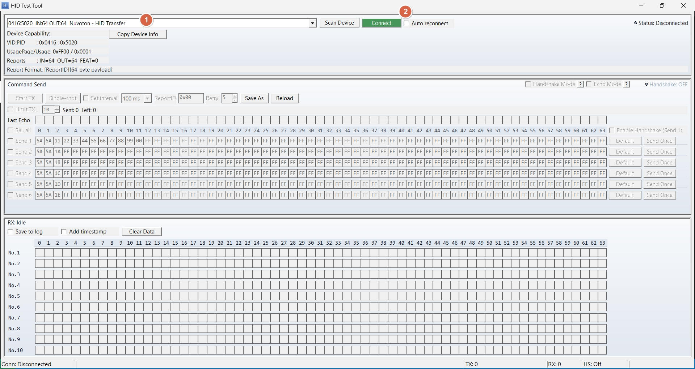

# HidTestTool

Windows MFC HID 測試工具（64-byte payload），用於送命令、收回應、驗證 Echo / Handshake 流程。




## Compiler-Only Clean

`scripts/clean_mfc.bat` and the existing clean entry remove known compiler files
only. Complete path/link preflight rejects reparse points before deletion;
EXE/INI/DLL/data/log/evidence/unknowns are preserved even under obj/tests/verify.
No additional manual setup is required.

## Build

Repository: [released/simple_hid_test_tool](https://github.com/released/simple_hid_test_tool).
舊網址 `released/HidTestTool` 會轉向同一個 HID repo，不能拿來上傳 TCP 工具。
建置會自動檢查專案身分、未解決合併標記並安裝 pre-push 防錯推檢查，不需額外手動安裝。
此檢查不會取代上傳前核對遠端實際內容；請勿使用 `--no-verify` 繞過。

```bat
scripts\build_release.bat
```

輸出：
- `build\HidTestTool.exe`
- `build\obj\x64\Release\HidTestTool.pdb`

`build_release.bat` 行為：
- build 前會先關閉正在執行的 `HidTestTool.exe`
- build 成功後會自動重新開啟 `build\HidTestTool.exe`

## Clean（保留 exe）

```bat
scripts\clean_build.bat
```

行為：
- 僅清除已明列的編譯／連結暫存檔，不會淨空 `build\`。
- 保留 EXE、INI、必要 DLL、資料、log、測試證據與其他未知交付檔案。

統一入口：`scripts\build_release_mfc.bat`、`scripts\clean_mfc.bat`；舊入口仍可使用。

## 啟動與介面

畫面由上到下：
1. DeviceBar
2. TX Panel（Command Send）
3. RX Panel（Monitor）
4. Status Bar

啟動時：
- 先顯示輕量 splash：`Initializing HID Test Tool...`
- 主視窗內不使用 overlay
- 初始掃描由 timer 延後觸發

## 快速使用

1. 按 `Scan Device`。
2. 在 Device Capability 確認目標 HID：
   - `UsagePage/Usage = 0xFF00 / 0x0001`
   - `IN=64 OUT=64`
3. 按 `Connect`。
4. 在 TX row 填入命令，勾選要送的列。
5. 用 `Single-shot`（單次）或 `Start TX`（連續）。
6. 在 RX panel 觀察回應。

## DeviceBar 重點

- Device 清單格式：`VID:PID  IN:xx OUT:xx  [Manufacturer - Product]`
- `VID:PID` capability 列有高對比底色，便於快速辨識
- 多 HID 裝置時，請先核對 `UsagePage/Usage` 再連線，避免連錯介面

## TX Panel 重點

- 每列：`Send N` + 64-byte hex + `Default` + `Send Once`
- `Default`：該列重設為 `FF * 64`
- `Set interval` 未勾選時固定 `100 ms`
- `Save As` / `Load`：匯出/匯入 command ini
- `Echo Mode` 與 `Handshake Mode` 互斥

Echo Mode 自動命令：
- Enable：`5A 5A EE 01` + 後續補 `00`
- Disable：`5A 5A EE 00` + 後續補 `00`

Handshake Mode：
- `Send 1` 視為 handshake key command
- 啟用時 `Send 1` 相關欄位會鎖定（灰化）
- 每個 TX cycle 先送 key，收到完全相同 echo 後才送 Row2~Row6

## RX Panel 與 Log

- 顯示最近 10 筆 RX（最舊在上、最新在下）
- `Save to log` / `Add timestamp` 永遠可用
- `Clear Data` 只在 disconnected 時可用

Log：
- 檔名：`YYYYMMDD_HHMMSS_hid_rx.log`
- 路徑：與 `HidTestTool.exe` 同層
- 內容含 TX + RX，格式：
  - 無時間戳：`[TX] [<hex>]` / `[RX] [<hex>]`
  - 有時間戳：`[HH:MM:SS.mmm] [TX] [<hex>]` / `[HH:MM:SS.mmm] [RX] [<hex>]`

## 設定檔

- `HidTestTool.ini`：主設定
- `HidTestTool_commands.ini`：目前 TX row 內容
- `HidTestTool_commands_default.ini`：預設模板

首次啟動：
- 若缺 `HidTestTool_commands.ini`，會以 UI 預設（`FF * 64`）建立
- 若缺 `HidTestTool_commands_default.ini`，會建立預設模板檔

---

# HidTestTool (English)

Windows MFC HID test tool (64-byte payload) for command TX/RX, Echo mode, and Handshake flow validation.

## Build

```bat
scripts\build_release.bat
```

Outputs:
- `build\HidTestTool.exe`
- `build\obj\x64\Release\HidTestTool.pdb`

`build_release.bat` behavior:
- Stops running `HidTestTool.exe` before build
- Relaunches `build\HidTestTool.exe` after successful build

## Clean Compiler Intermediates

```bat
scripts\clean_build.bat
```

Behavior:
- Removes known compiler/linker intermediates such as `build\obj` and debug symbol files
- Preserves EXE, INI/profile files, required DLLs, data, logs, and unknown delivery files

## Startup and Layout

Window order (top to bottom):
1. DeviceBar
2. TX Panel (Command Send)
3. RX Panel (Monitor)
4. Status Bar

On startup:
- Shows lightweight splash: `Initializing HID Test Tool...`
- No main-window overlay
- Initial device scan is deferred by timer

## Quick Start

1. Click `Scan Device`.
2. In Device Capability, confirm target HID:
   - `UsagePage/Usage = 0xFF00 / 0x0001`
   - `IN=64 OUT=64`
3. Click `Connect`.
4. Edit TX row bytes and enable rows to send.
5. Use `Single-shot` (one cycle) or `Start TX` (continuous).
6. Observe responses in RX panel.

## DeviceBar Notes

- Device list format: `VID:PID  IN:xx OUT:xx  [Manufacturer - Product]`
- `VID:PID` capability row has contrast highlight for quick identification.
- If multiple HID devices exist, verify `UsagePage/Usage` before connect.
- `Reports` row includes `IN/OUT/FEAT` and current `ReportID=0xNN`.
- Separate Report hint row is removed.

## TX Panel Notes

- Per row: `Send N` + 64-byte hex + `Default` + `Send Once`
- `Default` resets the row to `FF * 64`
- If `Set interval` is unchecked, scheduler uses fixed `100 ms`
- `Save As` / `Load` for command ini export/import
- `Echo Mode` and `Handshake Mode` are mutually exclusive

Echo mode auto commands:
- Enable: `5A 5A EE 01` + remaining `00`
- Disable: `5A 5A EE 00` + remaining `00`

Handshake mode:
- `Send 1` is treated as handshake key command
- `Send 1` controls are locked (greyed out) while handshake mode is on
- Each TX cycle sends key first; only exact echo match allows Row2~Row6

## RX Panel and Log

- Shows last 10 RX packets (oldest top, newest bottom)
- `Save to log` / `Add timestamp` always enabled
- `Clear Data` enabled only when disconnected

Log:
- Filename: `YYYYMMDD_HHMMSS_hid_rx.log`
- Location: same folder as `HidTestTool.exe`
- Includes both TX and RX lines:
  - No timestamp: `[TX] [<hex>]` / `[RX] [<hex>]`
  - With timestamp: `[HH:MM:SS.mmm] [TX] [<hex>]` / `[HH:MM:SS.mmm] [RX] [<hex>]`

## Config Files

- `HidTestTool.ini`: main settings
- `HidTestTool_commands.ini`: runtime TX rows
- `HidTestTool_commands_default.ini`: default template

First launch behavior:
- If `HidTestTool_commands.ini` is missing, it is created from UI defaults (`FF * 64`)
- If `HidTestTool_commands_default.ini` is missing, default template file is created
